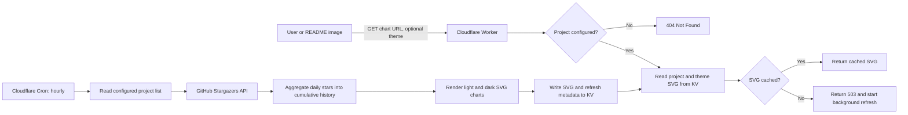

# Design

## Goal

Starfolio Worker generates SVG charts of cumulative GitHub stars for a configured set of repositories. It serves the generated charts from Cloudflare KV and refreshes them on a schedule, so chart readers do not need to wait for GitHub API requests or expose GitHub credentials.

## Request And Refresh Flow



The two flows are independent in normal operation:

- The public request flow only reads a completed SVG from KV.
- The scheduled refresh flow fetches GitHub data, renders both themes, and updates KV.
- A request only triggers a background refresh when its cache entry does not yet exist, such as immediately after initial deployment or after a manual cache deletion.

## Components

| Component | Responsibility |
| --- | --- |
| `src/projects.js` | Public registry of URL-safe project slugs and GitHub `owner/repository` values. |
| `src/index.ts` | Worker routes, project and theme validation, KV reads, scheduled refresh orchestration, and GitHub API access. |
| `src/chart.js` | Converts star timestamps into cumulative series data and renders SVG for the selected theme. |
| Cloudflare KV | Stores generated SVG content and `refreshedAt` metadata. |
| Cloudflare Cron Trigger | Invokes `scheduled()` every hour. |
| GitHub API | Supplies `starred_at` timestamps for configured public repositories. |
| `GITHUB_TOKEN` Worker Secret | Authenticates GitHub API requests; it is never returned to users or committed to the repository. |

## Public Routes

| Route | Behavior |
| --- | --- |
| `GET /` | Health check. Returns `200` with `{"status":"ok"}`. |
| `GET /star-history/{project}` | Returns the configured project's light SVG chart. |
| `GET /star-history/{project}?theme=dark` | Returns the configured project's dark SVG chart. |
| Unknown route, project, or theme | Returns `404 Not Found`. |
| Known project without a KV entry | Returns `503` with `Retry-After: 10` and starts a background refresh. |

## Cache Model

The Worker writes a separate cache entry for each project and theme:

```text
star-history:{project}:light
star-history:{project}:dark
```

Each entry stores:

- The complete SVG document.
- KV metadata containing the ISO 8601 `refreshedAt` timestamp.

The SVG response includes `X-Star-History-Refreshed-At` so consumers can inspect its source refresh time. HTTP responses are publicly cacheable for five minutes; KV is the longer-lived generated-chart cache.

## Data And Rendering

For every configured repository, the refresh job:

1. Requests GitHub's stargazers endpoint with the `application/vnd.github.star+json` media type.
2. Reads each stargazer's `starred_at` timestamp.
3. Groups stars by UTC date.
4. Accumulates each day's additions into the total-star series.
5. Draws a smooth cumulative curve and five display-only date ticks.
6. Renders light and dark SVG variants, including a final total-star label to the right of the curve endpoint.

The date ticks do not aggregate the underlying data. All dates on which at least one star was received remain source points for the curve.

## Failure Behavior

| Condition | Behavior |
| --- | --- |
| Unknown project | Reject before reading KV or calling GitHub, with `404`. |
| GitHub API error or rate limit | Log the refresh failure. Keep serving the last successful KV chart, if one exists. |
| First refresh fails before any SVG exists | Return `503` for the requested chart until a refresh succeeds. |
| One configured project fails during Cron | Log that project failure while other projects continue refreshing. |
| KV propagation delay after a write | A recently refreshed variant can briefly return `503`; clients should honor `Retry-After`. |

## Deployment Configuration

The public repository must not contain deployment-specific IDs or tokens. GitHub Actions creates a temporary `wrangler.jsonc` from the committed template and injects deployment values through repository configuration.

| GitHub configuration | Purpose |
| --- | --- |
| `CLOUDFLARE_API_TOKEN` secret | Authenticates the deployment workflow to Cloudflare. |
| `CLOUDFLARE_ACCOUNT_ID` secret | Selects the Cloudflare account. |
| `GITHUB_STAR_TOKEN` secret | Written to the Worker as the `GITHUB_TOKEN` runtime secret. |
| `CLOUDFLARE_WORKER_NAME` variable | Chooses the deployed Worker name. |
| `CLOUDFLARE_KV_NAMESPACE_ID` variable | Binds the deployment to the intended KV namespace. |

The Worker name is deployment configuration, not an application-level project setting. Repository chart configuration remains in `src/projects.js`.
